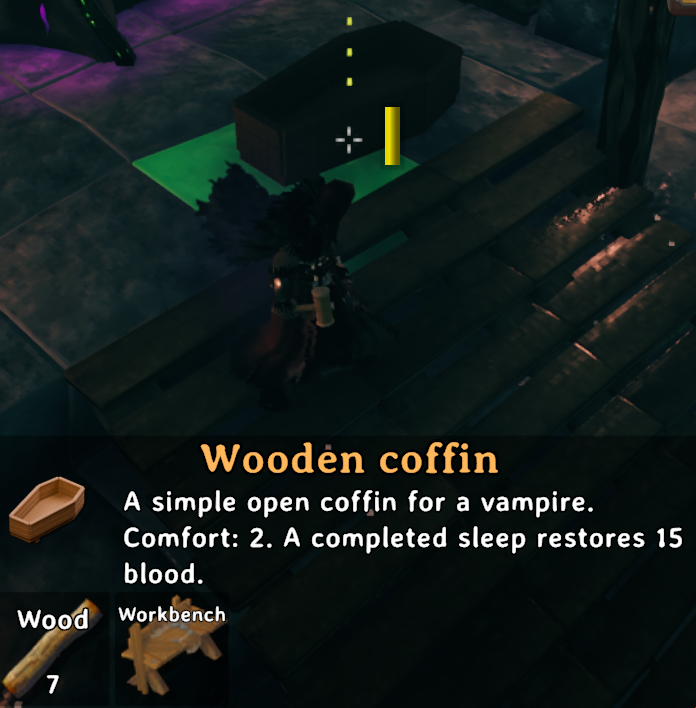
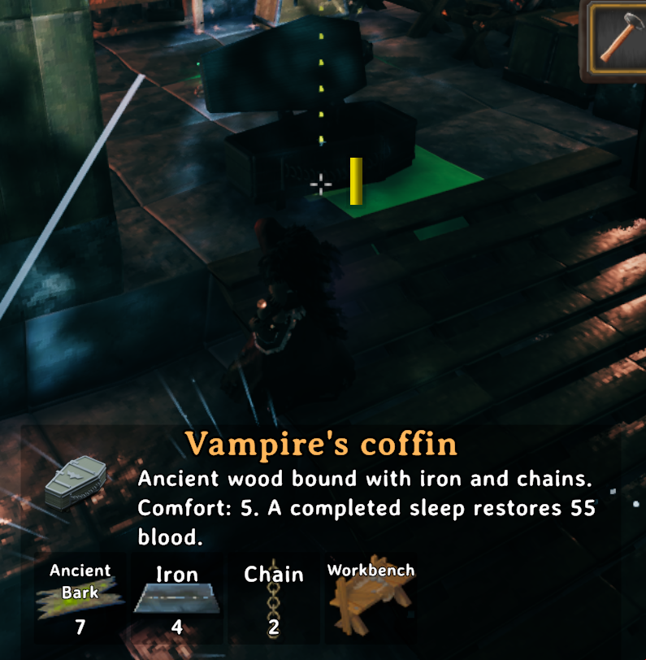

# Vampirizm

A vampirism mod for Valheim. Become a vampire, give up food, live on blood, hide from the sun, and level up the **Vampirism** skill to unlock a dash, invisibility and a bat form.

New to the mod? Read the simple **[Player Guide](PLAYER_GUIDE.md)**.

## Features

- **Vampire state and skill.** A new `Vampirism` skill (0–100) that grows by drinking blood. It is saved with the character and synced to other players.
- **Blood instead of food.** Vampires cannot eat food. Maximum health, stamina and regeneration come from stored blood. Meads still work. Blood drains slowly over time.
- **Passive eitr.** From Vampirism level 50 you get an eitr bar that grows with the skill: 300 eitr and 11 eitr/s at level 100.
- **Blood HUD.** A vertical blood bar with a blood drop icon sits right of the health bar and forsaken power and matches the health bar size. It pulses when blood is low.
- **Drinking from items.** Raw meat and blood items can be drunk from the inventory or hotbar.
- **Bite.** Drink blood directly from living creatures with a bare-handed bite. Works in multiplayer.
- **Vampire fists.** Bare-handed damage grows with the skill: ×1 at level 0 up to ×5 at level 100.
- **Weaknesses.**
  - Sunlight burns you during the day when you are not under a roof. Rain halves it, thunderstorms stop it; it never burns in the Swamp or Mistlands and burns twice as hard in the Ashlands.
  - The cold can't hurt you: no Cold or Freezing status effect.
  - Silver weapons and spirit damage deal ×2 damage to vampires.
  - Carrying silver burns: 5 damage per second for each inventory stack of silver.
- **Day sleep.** Vampires can sleep in their bed during the day and wake up at dusk.
- **Slime protection.** Smear yourself with Ooze to resist the sun for a while. Water and rain wash it off.
- **Conversion.**
  - Bite a willing player to turn them.
  - Use the craftable **Vampire Rune** on a clear night under open sky.
- **Abilities**, unlocked by skill level:
  - **Dash** (level 10): a short, fast burst of movement.
  - **Invisibility** (level 25): mobs and bosses ignore you and other players can't see you.
  - **Bat form** (level 50): fly as a bat and bite from the air.
- **Orb of Vampire.** A craftable one-handed orb that summons blood bats: a swarm that bites the creature you aim at and brings back blood, or a circle of bats that guards you and takes creature hits. Costs eitr, uses Blood magic.
- **Bats are friendly.** Cave bats never attack vampires, even when hit. Vampires can still kill them.
- **Rebindable controls** on Valheim's Controls tab, plus optional gamepad buttons.
- **English and Russian** localization.
- **Server-synced settings.** Gameplay settings come from the server (via Jotunn), so every player uses the same rules.

## Installation

1. Install [BepInEx 5](https://valheim.thunderstore.io/package/denikson/BepInExPack_Valheim/) (tested with 5.4.23.3).
2. Install [Jotunn 2.30.2](https://github.com/Valheim-Modding/Jotunn/releases/tag/v2.30.2).
3. Copy `Vampirizm.dll` into `BepInEx/plugins/Vampirizm/`.

The server and all clients must run the same Vampirizm version, and Jotunn checks this when you connect. The mod has been tested with Valheim 1.0.17.

## How to play

### Becoming a vampire

You can be turned in one of two ways:

- **Vampire Rune.** Craft it at a **Workbench** from `Leech trophy ×1 + Stone ×1 + Ruby ×2`. Use it from the inventory or hotbar **at night, in clear weather (no rain, storm, snow, mist, fog or ash), under open sky** (not under a roof or in a dungeon). If any of these conditions isn't met, you'll see the reason and the rune is not spent. When it works, a blood vortex gathers around you under a growing red glow, then red lightning strikes: a column of blood, a shockwave and a camera shake. Nearby players see it too.
- **Bite from another vampire.** A vampire can turn you by biting, unless the server has disabled it or you turned off `Accept conversion by bite` in your local config.

After you turn, your food is cleared and you start with 25% of your blood capacity.

### Living on blood

- **No food.** Food is refused and not used up; its tooltip says vampires cannot consume it. Meads still work (server setting `Allow meads`). Bait and other non-food items still work.
- **Blood items in the food bar.** Drinking a blood item (raw meat, blood bags) puts it in the vanilla food list with a 20-minute timer (`Blood item food time`) that burns twice as fast (`Food burn multiplier`). Up to three different blood items fit, and the same one can be drunk again only once its icon starts blinking. That entry adds no food stats; the blood itself does.
- **Blood capacity** is `100 + 2 × skill level`.
- **More blood means more health and stamina:**
  - max HP = base HP + 0.8 × blood
  - max stamina = base stamina + 0.5 × blood
  - Every 10 seconds you regenerate 0.04 × blood HP.
  - Drinking does not heal you instantly.
- **Eitr.** The skill gives eitr starting at level 50.
  - max eitr = 50 + 5 × (skill level − 50), so 300 at level 100
  - regen = 1 + 1 per 5 levels above 50 eitr/s, so 11/s at level 100. It does not depend on stored blood.
  - This rate replaces vanilla's base eitr regen. Magic armor regen bonuses and status effects still multiply it, and it pauses for 1 s after you use eitr, as in vanilla.
- **Drain.** You lose 3 blood per minute while playing. At zero blood you keep only your base HP and stamina.
- **Drinking items.** Use raw meat or blood items from the inventory or hotbar. The tooltip shows how much blood each item gives.
  - With a full bar, nothing is consumed.
  - Blood beyond your capacity is lost.
  - Items give skill experience: 2 XP per unit of blood that actually entered your bar.
  - You can still put raw meat on a cooking station normally.

| Item | Blood | Item | Blood |
|---|---|---|---|
| Neck tail | 6 | Lox meat | 20 |
| Raw meat (boar) | 10 | Serpent meat | 20 |
| Deer meat | 10 | Asksvin meat | 22 |
| Chicken meat | 10 | Volture meat | 22 |
| Hare meat | 12 | Bloodbag | 25 |
| Wolf meat | 15 | Giant blood sack | 35 |
| Bjorn meat | 18 | Bloody stew | 35 |

**Bloody stew** is crafted at the food preparation table (`piece_preptable`). One recipe requires **Deer meat ×1 + Raw meat (boar/pork) ×1 + Bjorn meat ×1 + Bloodbag ×1** and produces one stew (`VampirizmBloodyStew`). Only vampires can consume it. It restores **35 blood** immediately and occupies a food slot for **25 minutes** at the normal world food rate. The vampire food burn multiplier and generic blood-item duration do not shorten its timer. Like other food, it can be eaten again after half its duration; a full blood bar does not consume it. Its blood value is fixed and works with existing server configs.

Other cooked dishes, fish and vanilla blood pudding give no blood. The mod adds five more vampire-only foods. Each occupies a 20-minute food slot unaffected by the vampire food burn multiplier, and raises the listed skills by **+15** while its food slot lasts (shown in the skills dialog; bonuses from different foods stack). Seeker blood jelly and serpent blood aspic also add max eitr and **+20%** eitr regen each (stacking to +40%). Below the eitr unlock level this food eitr refills at the base regen rate:

| Food | Station | Blood | Skill bonus | Eitr | Recipe |
|---|---|---:|---|---|---|
| Crimson jerky | Food preparation table | 20 | Run | — | Deer meat ×2 + Bloodbag ×1 |
| Hunter's tartare | Food preparation table | 30 | Swords, Knives, Spears, Bows | — | Wolf meat ×1 + Bloodbag ×1 + Onion ×1 |
| Black blood pudding | Cauldron | 35 | Blocking (parry) | — | Giant blood sack ×1 + Barley flour ×2 + Cloudberry ×2 |
| Seeker blood jelly | Cauldron | 45 | Blood magic, Jump | +20, regen +20% | Giant blood sack ×1 + Raw seeker meat ×2 + Royal jelly ×2 |
| Serpent blood aspic | Cauldron | 40 | Swim | +25, regen +20% | Serpent meat ×2 + Giant blood sack ×1 |

Each vampire food has its own world model: a matching vanilla dish with a custom blood-themed texture (generated from the vanilla texture by `Assets/generate_food_textures.py` and embedded in the DLL), so drops are recognizable on the ground.

**Placing food in the world.** Bloody stew and the five vampire foods can be placed like vanilla feasts: equip the vanilla **Serving Tray** and pick the dish from its **Food** tab (it consumes one item from the inventory). A placed dish is eaten in the world with **Use** — only a vampire can eat it, and it grants the same blood as drinking it from the inventory. Removing it with the Serving Tray returns the item.

### Biting

To bite, have nothing in your hands (no weapon, shield or torch). Look at a creature within 2.5 m and **press the secondary attack** once. The whole bite then plays out by itself and always takes 2 seconds.

- **How it works.**
  - While you bite, you hold still and face the victim, raising both hands to your face (the `cry` emote, stretched over the whole bite).
  - At the end of every second the victim takes 6 damage, which armor does not reduce, and you gain 1.5 blood per point of damage. Nothing is dealt at the moment you bite; the last hit lands when the bite ends.
  - Most donors are lifted up to your mouth and held there while you drink. Large donors and bat bites stay where they are.
  - Small blood splats spray from the victim and a leech bite sound plays while you drink. Other players see and hear it too.
- **When it stops.** The bite ends after 2 seconds. If your blood bar fills earlier, draining stops but the bite still plays out. It ends early only when:
  - you are staggered or take a big hit
  - the target moves out of range or out of sight
  - either of you dies
  - You then have to wait 4 seconds before biting again.
- **Who you can bite.**
  - Boars, deer, necks, hares, chickens/hens, wolves, bjorns (bears), lox and goblins (Fulings) are donors.
  - Undead, greydwarves, blobs, surtlings, seekers, bosses and tamed creatures are never donors.
  - Goblin Brutes and bjorns give blood but are too big to hold.
- **Experience.** Bites give 4 XP per unit of blood that actually entered your bar (items give 2). A creature stops giving XP once you have drunk more blood from it than its max HP.
- **Players.** Biting a player never gives blood. Instead, it can convert them (see above).

### Weaknesses

- **Sun.**
  - **When it burns:** during the day, outside, not under a roof and not in a dungeon. Clouds and fog don't protect you. The sun stays harmless for the first 2 minutes after sunrise and the last 2 minutes before sunset.
  - **Weather and biome:** rain halves the damage, a thunderstorm stops it. No burning at all in the Swamp and Mistlands; the Ashlands burn ×2. Weather and biome multiply (Ashlands rain = ×1).
  - **Timing:** you get a warning first, then after 3 seconds you take damage every 2 seconds.
  - **Damage:** 1 + 2% of max HP per tick. Armor, blocking and dodging don't help.
- **Slime.** Use **Ooze** from the inventory to get 300 s of sun protection.
  - Using it again refreshes the timer; it does not stack.
  - Getting wet (rain, swimming) removes it at once, and you can't apply it while wet.
  - It does not survive relogging.
- **Silver and spirit.** Silver weapons and arrows (sword, mace, knife, arrows), and any hit with spirit damage, deal ×2 damage to you. Silver plus spirit together is still ×2, not ×4.
- **Carrying silver.** Silver in your inventory (ingots, ore, necklaces, silver weapons, arrows and shield) burns you for 5 damage every second **per stack**. A stack of 5 ingots, a silver sword and a silver necklace are 3 stacks, so 15 damage per second. Equipped items count too. Armor doesn't help.

### Sleeping

- A vampire can use its bed at any time of day, not only in the afternoon and at night. All other bed rules still apply: roof, fire, no enemies nearby, not wet, and the 30 s cooldown after waking.
- **Day sleep.** If you go to bed between the vanilla wake-up time (early morning) and nightfall, and **every player in the world is a vampire in bed**, time skips to just after dusk. You wake with "Good evening" and the Rested bonus, and the sun no longer burns.
- **Night sleep** works as in vanilla and skips to the next morning.
- **Mixed groups.** Regular players can't go to bed in the morning or at noon, so a day sleep needs everyone to be a vampire. In the afternoon, when everyone can sleep, a group with at least one regular player skips to the next morning as usual.

Vampires can claim and sleep in two coffins, built with the hammer under **Furniture** near a workbench:

| Coffin | Recipe | Comfort | Blood per completed sleep |
| --- | --- | --- | --- |
| Wooden coffin | 7 Wood | 2 | 15 |
| Vampire's coffin | 7 Ancient bark, 4 Iron, 2 Chain | 5 | 55 |




Coffins retain bed ownership, respawning, shelter/fire checks and the normal sleep cooldown. Blood is restored once when a living vampire wakes from an actual sleep, capped at blood capacity; simply lying down and getting up grants nothing. Both use the Bed comfort group, so their comfort does not stack with other beds. The wooden coffin has no lid; the vampire coffin's iron-trimmed lid closes while occupied and opens when vacated, including for remote players. The original models, textures, rendered icons and Blender generation script are in `Vampirizm/Assets/Coffins/` (see its README).

### Abilities

Abilities unlock as your Vampirism skill grows. They work only when you are a vampire and are not in a menu, chat or inventory.

| Ability | Default key | Unlocks at | Cost |
|---|---|---|---|
| Dash | `Left Alt` | level 10 | 5 blood, 2 s cooldown |
| Invisibility | `H` (toggle) | level 25 | 5 blood to activate, 15 blood/min while active, 2 s cooldown after exiting |
| Bat form | `B` (toggle) | level 50 | 5 blood to activate, 20 extra blood/min while active, 2 s cooldown after exiting |

Unlocked abilities appear as icons in the bottom-left corner of the HUD. Icons turn gray during cooldown and regain their color when ready. Activation requires enough blood to pay the full cost; a blocked attempt spends nothing. Invisibility and bat form can always be turned off immediately, and their cooldown also applies after a forced exit.

- **Dash.**
  - You dash up to 10 m in the direction you are moving, or forward if you aren't moving. The default speed is 80 m/s (about 0.125 s for 10 m).
  - The dash follows terrain height, uses the jump animation and leaves a faint, short-lived red trail. It stops at unsupported ledges.
  - It stops just before walls, steep slopes and creatures. If there is no room, it doesn't start and costs nothing.
  - You can't dash in the air, in water, while biting, attacking, dodging, sitting, overweight or in build mode.
  - There is no invulnerability during a dash.
- **Invisibility.**
  - Other players can't see you, and mobs and bosses won't target you. You see yourself as semi-transparent.
  - It ends when you attack, use an item, take damage, bite, dash, die or teleport, or when you press the key again.
  - A puff of smoke and a ghostly sound mark the moment you fade or reappear. Other players see and hear it too.
- **Bat form.**
  - You turn into a bat and fly. Movement keys steer, jump climbs and crouch descends.
  - Hold sprint to fly twice as fast. Sprinting in the air costs no stamina.
  - The bat squeaks and flaps its wings now and then, and a magic puff with a screech marks each transformation. Other players see and hear it too.
  - Items, interaction, building, attacks, parry and dodge are blocked.
  - Secondary attack bites for 20 damage and restores 5 blood per tick.
  - The form ends when you die, teleport, enter water, are staggered, are cured or run out of blood.

Rebind the abilities in **Settings → Controls** (rows named "Vampire: …"). Gamepad buttons can be set only in the config file (see [Controls](#controls)).

### Orb of Vampire

Crafted at a **Galdr table** (level 2) from 10 Ruby, 5 Eitr and 1 Surtling core. Upgrades add 5 Ruby and 5 Eitr per level, up to quality 3. The required table level is capped at what the Galdr table can reach, so the top quality stays craftable. Repaired at the Galdr table.

Hold it in the right hand (the left hand stays free for a shield or torch). Only vampires can cast; every cast plays the use animation, costs **55 eitr** reduced by Blood magic like vanilla staffs (−33% at level 100), uses 1 durability and raises **Blood magic**. Bat bites raise Blood magic too.

| Quality | Bats (swarm and shield) | Shield time | Durability |
|---|---|---|---|
| 1 | 7 | 200 s | 200 |
| 2 | 9 | 225 s | 250 |
| 3 | 11 | 250 s | 300 |

- **Primary attack: swarm.** Bats burst out of the orb toward the creature closest to your aim (30° cone, 30 m, line of sight). They circle it and dive one by one every 3 s, each bite dealing 7 pierce. Hits come from the bats, so the victim fights back against them. If the target dies, the swarm switches to the nearest enemy within 10 m. After 15 s the bats return to you with **3 blood each** if the last target was a donor creature, otherwise they fly away. With nothing in the cone the bats scatter. Only one swarm at a time.
- **Secondary attack: shield.** Bats circle you and dive at fighting monsters within 8 m. The nearest bat takes each creature hit for you; one bat can take at most one hit per 0.5 s. Casting again refreshes the time and tops the circle up. You can't raise a shield while a swarm is out.
- **Shield into swarm.** A primary cast while the shield is up sends the shield bats at the target instead of summoning new ones; the shield ends.
- Bats are real creatures with 15 health: monsters target and kill them. They are never saved with the world, and they fly away when you die, teleport or are cured. Tamed creatures, friendly-listed creatures and other players (unless both have PvP on) are never targeted.

### Death and cure

Death keeps your vampire status but halves your stored blood (see `Blood kept on death`). If your skill drops on death, your blood is also capped to the new capacity. There is no in-game cure yet, only the `vampirizm cure` debug command.

## Commands

Commands are for testing and admins. To use them:

1. Enable the in-game console, e.g. with the `-console` launch option.
2. Run `devcommands`.
3. For any command other than `status`, set `[Debug] Enable commands = true` in the server config (the local config in single-player). You must also be an admin.

The `vampirizm` command is hidden from `help` and autocomplete, and it only ever affects your own character.

| Command | Action |
|---|---|
| `vampirizm status` | Show your blood, capacity and skill level. No admin rights needed. |
| `vampirizm convert` | Turn yourself into a vampire (at least level 1), grant the starting blood and clear current food. Running it again does not refill blood. |
| `vampirizm cure` | Remove vampirism and reset blood to zero. The skill level is kept. |
| `vampirizm blood <amount>` | Add up to `<amount>` blood, up to your capacity. |
| `vampirizm level <0..100>` | Set the Vampirism skill level and reset XP progress for that level. |

Commands that change state are refused if:

- you are not an admin
- debug is off on the server
- your character isn't loaded or is dead
- you run them from a dedicated server console with no character

This is a co-op safeguard. It doesn't stop a modified client.

## Configuration

The config file is `BepInEx/config/com.igentuman.vampirizm.cfg`, and it is created on first launch. Settings marked **server** are admin-only: in multiplayer, the server's values are synced to all clients through Jotunn. Settings marked **local** belong to each player.

Item and creature lists are comma-separated, case-sensitive Valheim prefab IDs.

### `[Debug]`

| Setting | Default | Scope | Description |
|---|---|---|---|
| Enable commands | `false` | server | Allow admins to run the `vampirizm` commands that change state. |

### `[Blood]`

| Setting | Default | Scope | Description |
|---|---|---|---|
| Base capacity | `100` | server | Blood capacity at skill level 0. |
| Capacity per level | `2` | server | Extra capacity per skill level. |
| Initial blood fraction | `0.25` | server | Fraction of capacity given once on conversion. |
| Health per blood | `0.8` | server | Max HP per unit of stored blood. |
| Stamina per blood | `0.5` | server | Max stamina per unit of stored blood. |
| Health regen per blood | `0.04` | server | HP restored every 10 s per unit of stored blood. |
| Drain per minute | `3` | server | Blood lost per minute of play while alive. Scaled by the world food-rate modifier. Not lost while offline. |
| Blood kept on death | `0.5` | server | Fraction of stored blood kept when you die. `0.5` halves it, `1` keeps all of it. |

### `[Eitr]`

| Setting | Default | Scope | Description |
|---|---|---|---|
| Unlock level | `50` | server | Skill level that grants the eitr bar. Below it, a vampire has no eitr. |
| Base eitr | `50` | server | Max eitr at the unlock level. |
| Eitr per level | `5` | server | Extra max eitr per skill level above the unlock level. |
| Base regen | `1` | server | Eitr per second at the unlock level. Replaces the vanilla rate; armor and status effect bonuses still apply. |
| Regen bonus | `1` | server | Extra eitr per second for each regen step. |
| Levels per regen bonus | `5` | server | Skill levels above the unlock level per regen step. |

### `[Feeding]`

| Setting | Default | Scope | Description |
|---|---|---|---|
| Blood items | see [table](#living-on-blood) | server | `PrefabId:blood` pairs that vampires can drink from the inventory or hotbar. |
| Allow meads | `true` | server | Vampires can drink meads and other consumables that only apply a status effect. Food is always refused. |
| Food burn multiplier | `2` | server | How many times faster food bar entries run out for a vampire. Bloody stew is exempt. |
| Blood item food time | `1200` | server | Food timer in seconds a drunk blood item puts in the food list, before the burn multiplier. Adds no stats. Bloody stew has its own 1500-second timer. |
| Experience per blood | `2` | server | Skill XP per unit of item blood that enters the bar. |

### `[Weaknesses]`

| Setting | Default | Scope | Description |
|---|---|---|---|
| Sun damage | `1` | server | Flat damage per sun tick. |
| Sun damage fraction | `0.02` | server | Extra damage per tick as a fraction of max HP. |
| Sun interval | `2` | server | Seconds between sun ticks. |
| Sun warning | `3` | server | Seconds between the warning and the first tick. |
| Sun twilight | `120` | server | Real seconds after sunrise and before sunset when the sun does not burn. |
| Rain sun multiplier | `0.5` | server | Sun damage multiplier in wet weather. `0` disables burning. |
| Thunderstorm sun multiplier | `0` | server | Sun damage multiplier in a thunderstorm; replaces the rain multiplier. |
| Swamp sun multiplier | `0` | server | Sun damage multiplier in the Swamp. Multiplied with the weather multiplier. |
| Mistlands sun multiplier | `0` | server | Sun damage multiplier in the Mistlands. |
| Ashlands sun multiplier | `0.5` | server | Sun damage multiplier in the Ashlands. |
| Slime item | `Ooze` | server | Prefab ID of the sun-protection item. |
| Slime duration | `300` | server | Seconds of protection per application. |
| Slime emote | *(empty)* | server | Vanilla emote to play when applying it, e.g. `flex`. Empty uses the eat animation. |
| Silver items | `SwordSilver, MaceSilver, KnifeSilver, ArrowSilver` | server | Silver weapons and ammo. You could add e.g. `SpearWolfFang`, `FistFenrirClaw` or `BowDraugrFang`. |
| Silver and spirit multiplier | `2` | server | Damage multiplier for silver or spirit hits. It is applied only once. |
| Spirit rule | `WholeHit` | server | `WholeHit`: any spirit damage multiplies the whole hit. `SpiritOnly`: without silver, only the spirit part is multiplied. |
| Silver contact items | `Silver, SilverOre, SilverNecklace, SwordSilver, MaceSilver, KnifeSilver, ArrowSilver, ShieldSilver` | server | Items that burn you while carried anywhere in the inventory. |
| Silver contact damage | `5` | server | Damage per tick for each inventory stack of silver. `0` disables it. |
| Silver contact interval | `1` | server | Seconds between silver contact ticks. |

### `[Bite]`

| Setting | Default | Scope | Description |
|---|---|---|---|
| Donors | `Boar, Deer, Deer_White, Neck, Hare, Hen, Chicken, Wolf, Wolf_cub, Bjorn, Lox, Lox_Calf, Goblin, GoblinArcher, GoblinShaman, GoblinBrute` | server | Creatures you can drink from. Any creature not listed is forbidden. Bosses and tamed creatures never count. |
| Never donors | greydwarves, skeletons, draugr, unbjorns, ghosts, wraiths, blobs, surtlings, golems, seekers, ticks, deathsquitos | server | Always forbidden, even if also listed in Donors. |
| No hold donors | `Bjorn, Lox, GoblinBrute` | server | Donors that give blood but are not held in place. |
| Range | `2.5` | server | Maximum bite distance in meters. |
| Tick interval | `1` | server | Seconds between drain ticks. Damage lands at the end of each interval, never at the start of the bite. |
| Damage per tick | `6` | server | Damage dealt to the victim per tick. Armor does not reduce it. |
| Blood per damage | `1.5` | server | Blood gained per point of damage dealt. |
| Experience per blood | `4` | server | Skill XP per unit of bitten blood that enters the bar. |
| Max duration | `2` | server | Length of one bite, in seconds. |
| Cooldown | `4` | server | Seconds before the next bite. |
| Emote | `cry` | server | Vanilla emote played while drinking, e.g. `cry`, `kneel`. Empty uses a short interact animation. Not used in bat form. |
| Emote speed | `0` | server | Playback speed of the drinking emote. `0` stretches the whole emote over the bite length. |
| Sound | `sfx_leech_attack` | server | Vanilla sound prefab played when drinking starts and every tick interval. Empty disables it. |
| Blood effect | `vfx_player_hit` | server | Vanilla effect prefab spawned as small blood splats while drinking. Empty disables it. |
| Bite converts players | `true` | server | Whether biting a willing player turns them into a vampire. |
| Accept conversion by bite | `true` | **local** | Your consent to being turned by a bite. |

### `[Rune]`

| Setting | Default | Scope | Description |
|---|---|---|---|
| Blocked weather | `Rain, Storm, Snow, Mist, Fog, Ash` | server | Keywords (case-insensitive). If the current environment's name contains one, the rune won't work. Wet weather always blocks it. |
| Requires open sky | `true` | server | Whether the ritual fails under a roof or in a dungeon. |
| Start effects | `fx_GP_Activation` | server | Comma-separated vanilla effect prefabs played when the ritual starts. Empty disables them. |
| Strike effects | `fx_Lightning_red, sfx_thunder` | server | Comma-separated vanilla effect prefabs played at the ritual's climax. Empty disables them. |

### `[Abilities]`

| Setting | Default | Scope | Description |
|---|---|---|---|
| Unarmed damage multiplier | `5` | server | Bare-handed damage multiplier at skill 100. Scales linearly from ×1 at skill 0. |
| Dash level | `10` | server | Skill level that unlocks the dash. |
| Dash blood cost | `5` | server | Blood spent per dash. |
| Dash cooldown | `2` | server | Seconds between dashes. |
| Dash distance | `10` | server | Maximum dash length in meters. |
| Dash speed | `40` | server | Base speed in m/s, applied at 2× speed: `40` gives 80 m/s. A full 10 m dash takes about 0.125 s. |
| Invisibility level | `25` | server | Skill level that unlocks invisibility. |
| Invisibility blood cost | `5` | server | Blood spent when activating invisibility. |
| Invisibility cooldown | `2` | server | Seconds after invisibility ends before it can be activated again. |
| Invisibility blood drain per minute | `15` | server | Blood spent per minute while invisible. |
| Invisibility effect | `vfx_odin_despawn` | server | Vanilla effect prefab puffed when you fade or reappear. Empty disables it. |
| Invisibility sound | `sfx_ghost_death` | server | Vanilla sound prefab played when you fade or reappear. Empty disables it. |
| Bat form level | `50` | server | Skill level that unlocks bat form. |
| Bat form blood cost | `5` | server | Blood spent when entering bat form. |
| Bat form cooldown | `2` | server | Seconds after bat form ends before it can be activated again. |
| Bat flight speed | `8` | server | Flight speed in m/s. |
| Bat sprint speed multiplier | `2` | server | Flight speed multiplier while sprint is held. |
| Bat form blood drain per minute | `20` | server | Extra blood lost per minute as a bat. |
| Bat transform sounds | `sfx_raven_poof, sfx_bat_alerted` | server | Comma-separated vanilla sound prefabs, all played when you turn into a bat or back. Empty disables them. |
| Bat noise sounds | `sfx_bat_idle` | server | Comma-separated vanilla sound prefabs; one random pick per squeak. Empty disables them. |
| Bat noise interval | `6` | server | Average seconds between squeaks (randomized 0.5×–1.5×). |
| Bat flap sounds | `sfx_raven_flap` | server | Comma-separated vanilla sound prefabs; one random pick per wing flap. Empty disables them. |
| Bat flap interval | `2.5` | server | Average seconds between wing flaps (randomized 0.5×–1.5×). |
| Bat bite damage | `20` | server | Damage per bat bite tick. |
| Blood per bat bite | `5` | server | Blood restored per bat bite tick. |

### `[Orb]`

| Setting | Default | Scope | Description |
|---|---|---|---|
| Base eitr | `55` | server | Eitr per cast before the Blood magic reduction. |
| Skill eitr reduction | `0.33` | server | Fraction of the cost removed at Blood magic 100. |
| Base bats | `7` | server | Bats of a base quality orb, for swarm and shield. |
| Bats per level | `2` | server | Extra bats per upgrade. |
| Bat damage | `7` | server | Pierce damage per bite. |
| Bite interval | `3` | server | Seconds between dives of one bat. |
| Swarm duration | `15` | server | Seconds before the swarm returns or leaves. |
| Shield duration | `200` | server | Seconds a base quality shield lasts. |
| Shield duration per level | `25` | server | Extra shield seconds per upgrade. |
| Bat health | `15` | server | Health of one bat. |
| Cone angle | `30` | server | Full aiming cone in degrees. |
| Range | `30` | server | Maximum target distance in meters. |
| Blood per bat | `3` | server | Blood each surviving bat brings back from a donor. |
| Shield absorb | `1` | server | Fraction of a creature hit taken by a shield bat instead of you. |
| Cast delay | `0.35` | server | Seconds from the cast animation start until bats leave the orb. |
| Skill per cast | `1` | server | Blood magic experience per cast. |
| Skill per bite | `0.25` | server | Blood magic experience per bat bite. |
| Target bosses | `true` | server | The swarm may be cast at bosses. |

### `[Creatures]`

| Setting | Default | Scope | Description |
|---|---|---|---|
| Friendly to vampires | `Bat` | server | Comma-separated creature prefab IDs that never attack vampires. One-way: vampires can still attack them. |

### `[HUD]`

| Setting | Default | Scope | Description |
|---|---|---|---|
| Offset X | `0` | local | Horizontal offset of the blood bar from its spot right of the health bar and forsaken power. |
| Offset Y | `0` | local | Vertical offset of the blood bar from the bottom of the health bar. |

### `[Controls]`

| Setting | Default | Scope | Description |
|---|---|---|---|
| Dash key | `LeftAlt` | local | Keyboard or mouse key. Rebinding in the Controls menu saves here, and clearing a key saves `None`. |
| Invisibility key | `H` | local | Same as above. |
| Bat form key | `B` | local | Same as above. |
| Dash / Invisibility / Bat form gamepad button | `None` | local | Gamepad button. It can be set only here, because Valheim cancels rebinding when a gamepad button is pressed. Every gamepad button already has a vanilla action, so pick one you don't use. |

## Development

### Environment

- **.NET SDK 8** (`global.json`). The plugin targets `net462` and uses C# 8.
- **JotunnLib 2.29.2**, pinned in the project and in `packages.lock.json`; the plugin requires Jotunn 2.30.2 or newer at runtime.
- **Valheim 1.0.17** and **BepInEx 5.4.23.3** are verified for building and loading.
- The game uses the [official Jotunn release DLL](https://github.com/Valheim-Modding/Jotunn/releases/tag/v2.30.2). The NuGet DLL contains debug components and is not meant for installing into the game.
- The game assemblies (`assembly_valheim`, `assembly_utils`, `assembly_guiutils`, `SoftReferenceableAssets`) and Unity's `netstandard.dll` are referenced from the installed game, not from `publicized_assemblies`, so the build can't compile against stale copies.

Jotunn looks for Valheim in the default Steam directory. To use a different directory, set `VALHEIM_INSTALL`, and if needed `VALHEIM_MANAGED` and `BEPINEX_PATH`, as environment variables or MSBuild properties.

### Build and test

```bash
dotnet restore Vampirizm.sln --locked-mode
dotnet build Vampirizm.sln -c Release --no-restore
dotnet run --project Vampirizm.Tests -c Release
```

The output is `Vampirizm/bin/Release/net462/Vampirizm.dll`. After every Debug or Release build, including builds from Rider, the DLL is copied to `~/.local/share/Steam/steamapps/common/Valheim/BepInEx/plugins/Vampirizm/`. Only the mod DLL is deployed; dependencies are not.

```bash
# Custom deploy directory (or set MOD_DEPLOYPATH)
dotnet build Vampirizm.sln -c Release -p:VampirizmDeployPath=/path/to/Valheim/BepInEx/plugins/Vampirizm
# Build without deploying
dotnet build Vampirizm.sln -c Release -p:DeployVampirizmOnBuild=false
```

`Vampirizm.Tests` is a small executable test suite with no external test framework. It runs without Valheim or Unity and covers:

- conversion, blood overflow and consumption, drain
- blood item and ID list parsing
- silver/spirit multiplier, sun timer and damage, silver contact timer and per-stack damage
- donor rules, bite blood cap, tick ordering and session length
- day sleep window and dusk wake-up time
- ritual conditions, ability thresholds and block reasons, dash obstacle distance
- curing, capacity changes, save locale, migration
- restoring invisibility materials, checked against a Unity API model

These tests do not replace running the game.

### Project layout

| Folder | Contents |
|---|---|
| `Core/` | `VampireController` (per-player state machine), `VampireState`, blood, eitr and sleep rules |
| `Feeding/` | Blood item table, donor registry, drain rules |
| `Abilities/` | Bite (`DrainAbility`), dash, invisibility (+ visual), bat form, unlock rules |
| `Effects/` | Sunlight and slime protection |
| `Combat/` | Silver registry, friendly creature registry, hit source tracking, damage multiplier rules |
| `Conversion/` | Conversion and rune ritual rules |
| `Items/` | Vampire Rune and Bloody stew prefabs and recipes |
| `Networking/` | ZDO state replication, bite/drain RPCs |
| `Persistence/` | Save format |
| `Controls/` | Jotunn key bindings and Controls menu rows |
| `UI/` | Blood HUD bar |
| `Patches/` | Harmony patches (food, eitr, cold, sleep, damage, friendly creatures, HUD, persistence, abilities, bite, bat form, invisibility) |
| `Configuration/`, `Localization/`, `Skills/`, `Commands/` | Config, EN/RU strings, skill registration, console command |
| `Assets/` | Rune and Bloody stew icons, embedded in the DLL; stew generation prompt |

The plugin installs each Harmony patch class on its own. If one patch fails because a game method signature changed, the error is logged and the other systems still load.

### Technical notes

- **Saving.**
  - `Player.m_customData["com.igentuman.vampirizm.state"]` stores `1|0/1|blood` using the invariant locale. The skill level is saved by vanilla `Skills.Save`.
  - The prototype format `0|True/False|blood` is migrated.
  - Corrupted strings and unknown versions are left untouched, and state changes for that character are blocked with a warning in the log.
  - Regular characters get no state record.
- **Replication.**
  - The owner writes status, blood, level and bat form to the player's ZDO, only when they change. Blood updates about once per second because of drain.
  - Remote clients read this snapshot. For example, the silver multiplier detects a vampire target from its ZDO flag.
- **Bite networking.**
  - The victim's owner coordinates the bite. Every tick, the vampire's client sends the `Vampirizm_Drain` RPC with a session number and tick number.
  - Tick 1 is sent on the press and only claims the victim (validation and hold, no damage). Damage ticks follow at the end of each interval, the last one exactly at the session end; the bite waits for its reply before finishing.
  - The owner checks the sender, the vampire flag, distance, donor rules, session uniqueness and tick order. It then applies the damage and replies with the blood actually gained.
  - Duplicate and late replies are ignored.
  - The victim's AI is held only while the session is alive. The hold is released on timeout, owner change or death, so a vampire disconnecting doesn't leave the mob frozen.
  - When the vampire stops drinking, it sends `Vampirizm_DrainRelease` so the victim is let go at once instead of on timeout.
  - A held victim is lifted by its owner, so its position syncs like any other movement.
  - The vampire writes its drink target to its ZDO. Every client uses it to spawn the blood splats and sound locally.
  - Biting a player sends a one-off `Vampirizm_Bite` request instead.
- **Day sleep.**
  - The local vampire's `EnvMan.CalculateCanSleep` result is extended to daytime, because the tiny `EnvMan.CanSleep` getter may be inlined into `Bed.Interact`.
  - The server's `Game.UpdateSleeping` is preceded by a check: during the day, if every character ZDO is in bed and has the vampire flag, it sets up vanilla's time skip with the next dusk (0.76 of the day) as target and sends the vanilla `SleepStart`. Otherwise vanilla runs.
- **Silver and spirit detection.**
  - `HitData` doesn't record the weapon, so the mod remembers the weapon and ammo while the hit is built (`Attack.DoMeleeAttack/DoAreaAttack`, `Projectile.OnHit/DoAOE`, `Aoe.OnHit`).
  - It applies the multiplier in `Character.Damage` on the attacker's machine, on a copy of the `HitData`.
- **Invisibility visuals.**
  - Invisibility uses the `Custom/Fallen Warrior` shader from the `FallenWarrior` material, loaded via SoftRef.
  - The temporary materials are swapped in only during camera rendering, then the originals are restored.

### In-game test checklist

1. Client loads Jotunn 2.30.2 or newer and Vampirizm 0.3.0 (check the log). Dedicated server: not tested yet.
2. Convert, add blood and set the level. Then save, restart, and compare `status` and the skills menu.
3. Cure, switch character or world, die, and lower capacity. A regular character must eat and have stats normally.
4. Server: commands are refused without admin rights or with debug off, and settings sync.
5. Two clients: ZDO state on a remote player, late join, rejoin.
6. Blood: meat from the inventory and hotbar, a full bar, blood items in the food bar with 2× burn, food refused (red tooltip, not used up), meads drunk, cooking station with meat in hand, HUD position.
7. Sleep: bed at morning, noon and afternoon as a vampire (skips to dusk, "Good evening", Rested), at night (skips to morning), within 30 s of waking (refused), as a regular player during the day (refused). Two clients: two vampires in bed by day, and a vampire plus a regular player in the afternoon (skips to morning).
8. Sun: dawn and dusk (`skiptime`), roof edges, dungeons, rain and swimming with slime. Silver sword/arrow, spirit weapon, silver + spirit, armor vs. sun. Carrying silver: ingots, ore, sword and necklace stacks.
9. Rune: crafting, and refusals (day, rain, roof, already a vampire). Bite: allowed and banned donors, last HP, full 2 s session on a single press, target moving away, stagger. Two clients: bite a mob owned by the other client, two vampires on one target, logging out mid-bite, biting a player with and without consent.
10. Bat form and invisibility: toggling, flight and collisions, bat bite, drain, blocked actions, exit conditions, and what a remote or late-joining player sees. Check that activation costs 5 blood once, insufficient blood blocks entry without effects or spending, exiting costs nothing, and both manual and forced exits prevent reactivation for 2 seconds. Repeated blocked attempts must not extend cooldown.
    - HUD: icons appear at their configured unlock levels in the bottom-left corner, pack together without gaps for locked abilities, turn gray during cooldown, and regain color when ready. Check hidden HUD, death, cure, respawn and UI scaling.
11. Friendly bats: frost cave bats ignore a vampire and drop aggro after conversion; hitting one doesn't make it attack back; a regular player in the same cave is still attacked.
12. Dash: flat ground, uphill, downhill, hill crests, steps, a ledge, and a wall or creature in the path. Check the 80 m/s default, jump pose without lift, faint red trail and its fade after completion or interruption. Check that existing `Dash speed = 40` configs also get the doubled speed.
13. Bloody stew: one recipe at `piece_preptable`, requiring all four ingredients. Confirm 35 blood, a 25-minute food entry despite the vampire burn multiplier, no consumption at full blood or before the food refresh threshold, human refusal from inventory/hotbar, and the same remaining timer after saving and rejoining.
